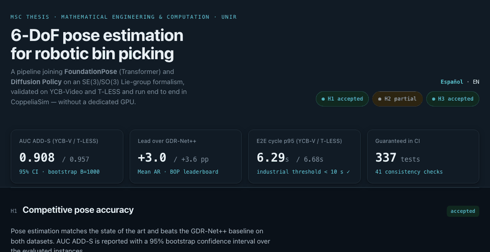

# 6-DoF Pose Estimation with Transformers and Diffusion Models for Robotic Bin Picking

**MSc thesis** · Master's in Mathematical Engineering & Computation · UNIR 2026

🌐 **English** · [Español](README.es.md)

[](https://giocrisrai.github.io/pose6dof-transformers-diffusion/)

[](https://github.com/Giocrisrai/pose6dof-transformers-diffusion/actions/workflows/ci.yml)
[](https://giocrisrai.github.io/pose6dof-transformers-diffusion/)
[](https://www.python.org/downloads/release/python-3120/)
[](LICENSE)
[](tests/)
[](https://pypi.org/project/bop-bootstrap-ci/)

A perception and planning pipeline for industrial bin picking. A robot has to pick
parts out of a bin where they lie in arbitrary poses, partly hidden by each other.
This work estimates the 6-DoF pose of each part with a Transformer, plans the grasp
with a diffusion model, and runs the whole cycle end to end in simulation:

- **FoundationPose** (Wen et al., CVPR 2024): 6-DoF pose estimation with 2D-3D cross-attention on SE(3).
- **GDR-Net++** (Wang et al., CVPR 2021): the baseline, direct geometry regression.
- **Diffusion Policy** (Chi et al., RSS 2023): multimodal grasp trajectories.

**Authors:** Giocrisrai Godoy Bonillo · José Miguel Carrasco — **Supervisor:** Ivón Oristela Benítez González

## Results

| Hypothesis | Criterion | Result | |
|---|---|---|:-:|
| **H1** Pose accuracy | AUC ADD-S, lead of ≥ 3 pp over GDR-Net++ | **0.908** [0.901, 0.916] on YCB-V · **0.957** [0.954, 0.959] on T-LESS | ✅ |
| **H2** Multimodal planning | score ≥ 0.95, sampling < 50 ms, ≥ 3 modes | score 0.96 · sampling 118 ms (DDIM-25) · 2 modes | ◐ partial |
| **H3** End-to-end cycle | p95 < 10 s per instance | **6.29 s** on YCB-V · **6.68 s** on T-LESS, on a MacBook Pro M1 | ✅ |

H2 is **partially accepted**, as stated in the thesis: the score criterion is met, but
diffusion sampling takes 118 ms against a 50 ms threshold and the policy shows 2 distinct
modes against a target of 3. Planning is still only 2.3% of the cycle time.

Intervals are 95% bootstrap confidence intervals (B = 1000). The lead over GDR-Net++
is +3.0 pp (YCB-V) and +3.6 pp (T-LESS) in Mean AR on the BOP leaderboard.

Two things worth knowing beyond the headline numbers:

- **Robustness.** On T-LESS, 70% occlusion costs only 1 pp of AUC ADD-S.
- **The bottleneck is named.** FoundationPose accounts for about 80% of the cycle time.

The [live dashboard](https://giocrisrai.github.io/pose6dof-transformers-diffusion/)
shows all of this with charts, an interactive 3D viewer and the simulation video.

## Try it

```bash
git clone https://github.com/Giocrisrai/pose6dof-transformers-diffusion.git
cd pose6dof-transformers-diffusion

uv sync --all-extras          # or: pip install -e ".[dev,colab]"

pytest tests/ packages/bop_bootstrap_ci/tests/ -q  # 317 passing (no GPU, no simulator)
```

The test suite needs neither a GPU nor the simulator. Tests marked `integration`
talk to CoppeliaSim on `localhost:23000` and are skipped when it is not running.

### The web app: dashboard and REST API

```bash
docker compose -f docker/docker-compose.yml up api      # CPU image, no GPU, no ROS
# Dashboard   http://localhost:8000/
# API docs    http://localhost:8000/docs
# Pipeline    POST /plan-grasp · POST /e2e · GET /metrics
```

Without Docker: `uv run uvicorn --app-dir scripts api_server:app --port 8000`.
The image in `docker/api.Dockerfile` deploys to any container host; see
[`docker/README-API.md`](docker/README-API.md).

### Other entry points

| What | Extra | Run |
|---|---|---|
| Results dashboard (Streamlit) | `dashboard` | `streamlit run dashboard.py` |
| Talk demo (Gradio + CoppeliaSim) | `demo` | `python scripts/demo_charla.py` |
| REST API (FastAPI) | `api` | `python scripts/api_server.py` |

### GPU evaluation on Google Colab

FoundationPose and GDR-Net++ inference need CUDA. The notebooks run on a free Colab T4:

| Notebook | Purpose |
|---|---|
| [](https://colab.research.google.com/github/Giocrisrai/pose6dof-transformers-diffusion/blob/main/notebooks/colab/00_colab_setup.ipynb) | Environment, BOP datasets, Google Drive |
| [](https://colab.research.google.com/github/Giocrisrai/pose6dof-transformers-diffusion/blob/main/notebooks/colab/01_foundationpose_eval.ipynb) | FoundationPose on YCB-V and T-LESS |
| [](https://colab.research.google.com/github/Giocrisrai/pose6dof-transformers-diffusion/blob/main/notebooks/colab/02_gdrnet_eval.ipynb) | GDR-Net++ baseline and comparison table |
| [](https://colab.research.google.com/github/Giocrisrai/pose6dof-transformers-diffusion/blob/main/notebooks/colab/03_results_analysis.ipynb) | Metric aggregation and final figures |

[`REPRODUCIBILITY.md`](REPRODUCIBILITY.md) covers the other routes: Kaggle, a GPU
container with pinned versions (`docker/inference-gpu.Dockerfile`), and local
analysis on a Mac without a GPU.

## How the numbers are kept honest

The figures in the thesis, the reports and the dashboards are checked on every push:

- **`scripts/verify_tfm_consistency.py`** compares the published results against the
  JSON reports they come from (30 checks).
- **`scripts/check_public_counts.py`** compares the test, check and type-checking
  counts printed in this README and in the dashboards with what the run just measured.
- **ruff** and **mypy** run clean, and the API image is built.

The raw evidence behind chapter 6 is versioned for audit under
[`experiments/results/foundationpose_eval/`](experiments/results/foundationpose_eval/):
the run card (commit, date, GPU, fixes applied), aggregated metrics and per-frame
predictions.

The bootstrap confidence intervals are released as a standalone package,
[`bop-bootstrap-ci`](https://pypi.org/project/bop-bootstrap-ci/)
(`pip install bop-bootstrap-ci`), which reproduces the thesis intervals bit for bit.

## Beyond the thesis

**Diffusion Policy retrained on simulator data.** Seven iterations, each evaluated on
50 picks in CoppeliaSim with a fixed seed. Supervised learning reached 60% full
pick-and-place success (Iter 5). Reinforcement-learning fine-tuning then *broke* the
grasp (28%), a negative result that is reported as such; a curriculum, best-of-N
trajectory selection and an inverse-kinematics fix brought it to **84%** (Iter 7c),
with IK convergence at 100%.

**Language-guided picking.** The pipeline can choose the object from an instruction
such as "give me the red cube on the left" instead of an index. The default parser
is deterministic (Spanish and English, no network, no weights); LLM backends plug in.

```python
from src.language import make_parser, Grounder
from src.language.schema import ObjectView

instr = make_parser("deterministic").parse("pick the red cube on the left")
objs = [ObjectView(0, (-0.2, 0.0, 0.5), {"color": "red", "shape": "cube"}),
        ObjectView(1, ( 0.2, 0.0, 0.5), {"color": "red", "shape": "cube"})]
Grounder(method="attribute").ground(instr, objs).target_obj_id   # 0, the left one
```

**Thirteen follow-up explorations**, each with a numeric success criterion, including
one-step distillation of the diffusion sampler, an open-licence perception pipeline
(Apache-2.0, about 3 pp of AUC below FoundationPose) and CLIP-based visual grounding.
Each has its own write-up in [`docs/exploraciones/`](docs/exploraciones/) (in Spanish).

The Spanish README has the full tables for all of these: [README.es.md](README.es.md).

## Repository layout

```
src/
├── perception/    FoundationPose, GDR-Net++ baseline, BOP evaluator
├── planning/      Diffusion Policy (DDPM + conditional 1D U-Net), grasp sampling
├── control/       Position-based visual servoing
├── language/      Instruction parser and grounding
├── simulation/    CoppeliaSim bridge, ROS 2 interface
└── utils/         SE(3)/SO(3) Lie groups, rotations, BOP metrics
packages/          bop-bootstrap-ci (published on PyPI)
experiments/       Evaluation scripts and versioned results
notebooks/         Colab notebooks and an end-to-end tutorial
docker/            API image, GPU inference image, ROS 2 + MoveIt 2
tests/             pytest suite
```

**Mathematical foundations:** Lie groups SE(3) and SO(3) with exponential and
logarithmic maps; rotation representations (unit quaternions, the continuous 6D
representation); multi-head attention; stochastic differential equations, score
matching and Langevin dynamics.

**Datasets:** T-LESS (30 texture-less industrial objects, the main benchmark) and
YCB-Video (21 household objects, for comparison with the literature), both RGB-D,
evaluated with the BOP metrics (VSD, MSSD, MSPD, ADD / ADD-S).

## Licence and citation

The code in this repository is released under the **MIT** licence
([`LICENSE`](LICENSE)). Third-party models, datasets and tools keep their own
licences, listed in `LICENSE`. Note in particular that FoundationPose is under the
NVIDIA Source Code License (academic, non-commercial use) and that the BOP datasets
are Creative Commons, some of them non-commercial.

If you use this code or its results, please cite the thesis as described in
[`CITATION.cff`](CITATION.cff).

## Main references

1. Wen et al. (2024). *FoundationPose: Unified 6D Pose Estimation and Tracking*. CVPR.
2. Wang et al. (2021). *GDR-Net: Geometry-Guided Direct Regression Network*. CVPR.
3. Chi et al. (2023). *Diffusion Policy: Visuomotor Policy Learning via Action Diffusion*. RSS.
4. Hodan et al. (2025). *BOP Challenge 2024*. CVPRW.
5. Liu et al. (2025). *Deep Learning-Based Object Pose Estimation: A Comprehensive Survey*. IJCV.
6. Cordeiro et al. (2025). *A Review of Visual Perception for Robotic Bin-Picking*. R&AS.
